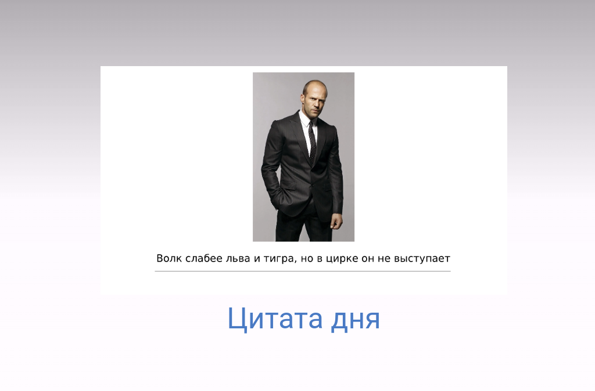

# Приложение "Цитата дня"

**Тема:** Цитата дня (Вариант 3). Приложение показывает случайную цитату из заранее подготовленного списка при нажатии на кнопку.

## Автор
- **Фамилия, Имя:** Афанасьев Глеб Викторович
- **Группа:** ИСП-242
- **Дата сдачи:** 10.11.2026

## Стек и версии
- **Flutter:** 3.47.6
- **Dart:** 3.13.5
- **Платформа:** Web (Chrome)
- **IDE:** VS Code

## Скриншот приложения


## Структура проекта
* lib/
* * dice_roller.dart - выбор случайной цитаты
* * gradient_container.dart - градиентовый фон
* * main.dart - основной код

## Как запустить
```bash
git clone https://github.com/Fraay/Flutter_Lab5
cd my_app_afanasev 
flutter pub get
flutter run -d chrome
```

## Что изучили

1. Научился создавать собственные виджеты.

2. Разобрался как задавать свои цвета и менять их в градиентовом фоне.

3. Научился использовать StatefulWidget и SetState().

4. Поработал с вставкой изображения в виджеты.

5. Разобрался с работой randomizer.

## Ответы на вопросы

1. Зачем выносить виджеты в отдельные файлы? Что изменится если держать всё в main.dart?

Вынос виджетов в отдельные файлы делает код модульным, чистым и удобным для чтения. Если держать всё в `main.dart`, файл быстро станет огромным (сотни строк), в нём будет сложно ориентироваться, а также возникнут проблемы при командной работе (конфликты при слиянии Git). Отдельные файлы проще переиспользовать в других проектах.

2. Что такое BuildContext? Почему метод `build()` принимает его как параметр?

`BuildContext` — это ссылка на местоположение виджета в дереве виджетов. Он нужен виджету, чтобы знать, где он находится, и иметь доступ к родительским данным (например, к теме оформления или размерам экрана). Метод `build()` принимает контекст, потому что Flutter вызывает его при каждой перерисовке и передаёт актуальную информацию о том, куда именно в дереве нужно встроить этот виджет.

3. Чем StatelessWidget отличается от StatefulWidget? Приведите пример когда нужен каждый из них.

`StatelessWidget` не имеет изменяемого состояния и перерисовывается только при пересоздании (например, текст, иконка, наш градиентный фон). `StatefulWidget` хранит состояние, которое может меняться, и для перерисовки использует метод `setState()` (например, наша кнопка, которая меняет цитату, или поле ввода текста).

4. Почему `Random()` создаётся на уровне файла, а не внутри `rollDice()`?
Если создавать `Random()` внутри метода (например, при каждом нажатии кнопки), то каждый раз будет инициализироваться новый генератор, который использует текущее время в миллисекундах. При очень быстрых нажатиях числа могут повторяться. Создание `Random()` на уровне файла гарантирует, что генератор создаётся один раз при запуске приложения, и последовательность случайных чисел будет качественной и непредсказуемой.